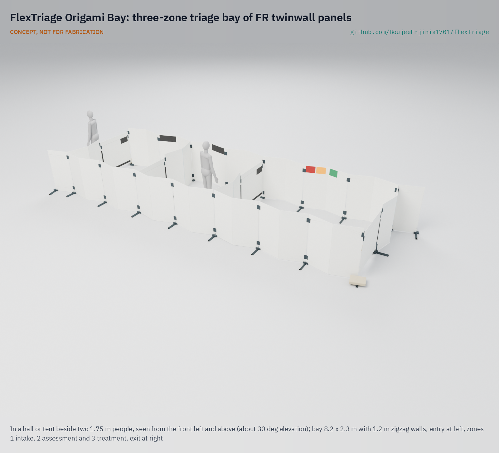
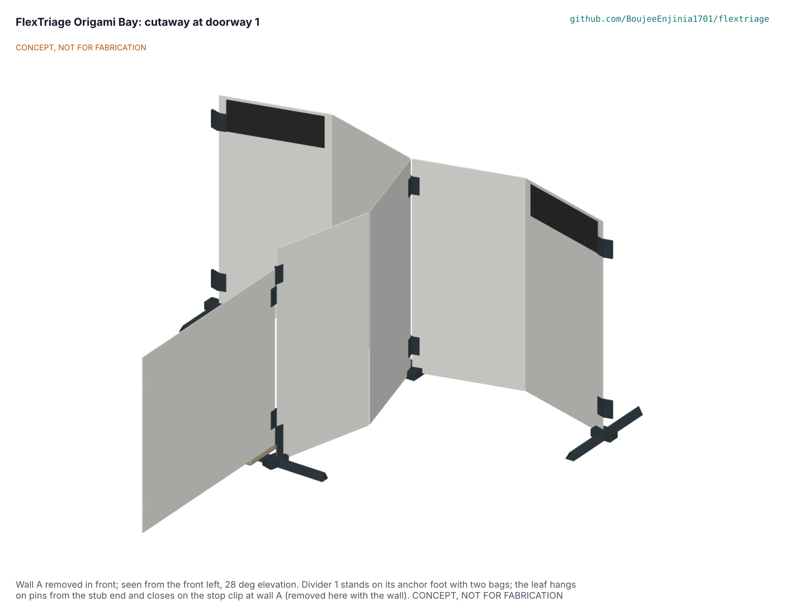
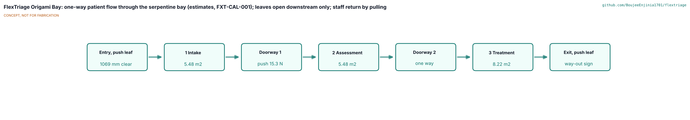
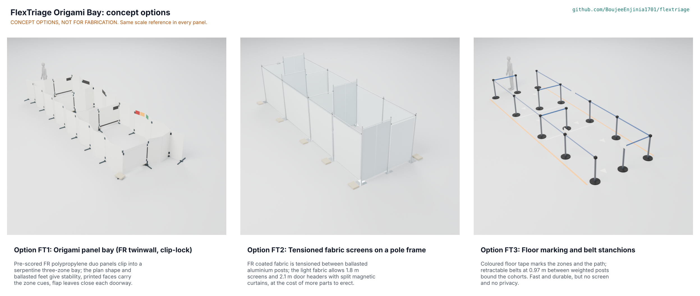
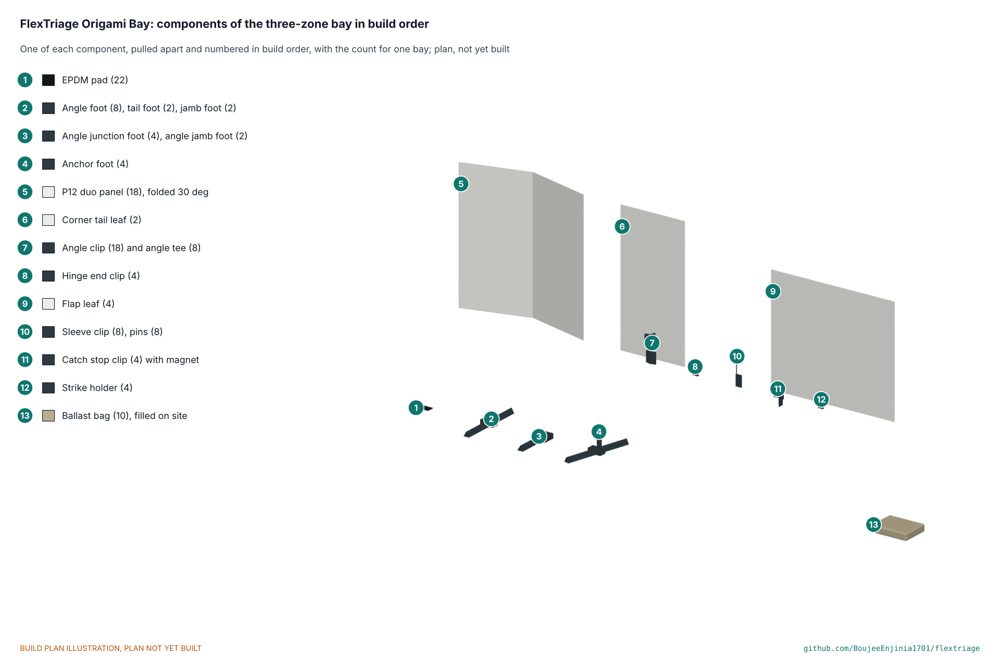

# FlexTriage Origami Bay



CONCEPT, NOT FOR FABRICATION. [Studio view](media/render-studio.png) · [Exploded render](media/render-exploded.png) · [Concept render](media/hero.png)

    [](https://github.com/BoujeeEnjinia1701/flextriage/actions/workflows/reuse.yml)

**Area:** Healthcare and emergency response · **TRL:** 3 of 9 (proof of concept on paper; stage P3) · **Value-engineering target:** USD 800 per three-zone bay (estimate USD 1,174.23) · **Difficulty:** 3 of 5 · **Partner:** Helpful Engineering

A flat-pack bay of folding flame-retardant polypropylene panels that two people clip together, without tools, into intake, assessment and treatment zones with a one-way path, numbered and worded signs and a swinging leaf at each doorway. It supports a receiving team's triage and infection prevention and control (IPC) practice in surge, mass casualty and outbreak response; it is a boundary, not a barrier. Built on the shared Flex panel and connector platform (FXP-PLT-001). The choice between this origami bay (FT1), floor marking with belt stanchions (FT3) and fabric screens on a pole frame (FT2) is **proposed, awaiting Amish**.

[Hero (concept render)](media/hero.png) · [Cutaway](media/cutaway.png) · [Exploded view](media/exploded.png) · [Patient flow](media/flow.png) · [Interactive 3D model](media/viewer.html) · [Concept blueprint (PDF)](media/concept-blueprint.pdf) · [General arrangement FXT-DWG-001 (PDF)](cad/drawings/FXT-DWG-001.pdf) · [Doorway FXT-DWG-002 (PDF)](cad/drawings/FXT-DWG-002.pdf) · [Sizing note FXT-CAL-001](docs/04-calcs/01-sizing.md) · [STEM check](docs/01b-stem-check.md) · [Prototype build plan](docs/05-build-plan.md) · [Decisions](docs/06-design-decisions.md) · [Review](docs/REVIEW.md)

## Concept rationale

Triage is improvised with tape, tarps and whatever is to hand, so cohorts mix and nobody can see where to go. A folding panel bay gives continuous 1.2 m walls that people stay inside, doorways at alternate sides that make the path one way, and large printed faces for cues. The physics sets the limits: a 1.2 m twinwall wall weighs little, so it stands a push only where a short panel braces it, and a bay big enough for three zones needs about 32 m2 of sheet, so it weighs about 43 kg, not 12. And a flat 1.2 m panel can buckle under its own weight in a hot tent, so every wall zigzags. This repo keeps the Helpful Engineering team's aim (pre-scored panels, tool-free clip-lock joints, printed cues, magnetic flaps, two people, no training) and builds it round those numbers.

Design thesis: **a clear one-way path that anyone reads the same way, from one sheet grade and a printer, honest about what a light wall can stand.**

## Burning platform

- WHO's guidance for triage stations asks for seats at least 1 m apart and "one-way into the station and one-way out of the station" ([WHO AFRO](https://www.afro.who.int/sites/default/files/Covid-19/Techinical%20documents/Establishing%20COVID-19%20triage%20stations%20at%20healthcare%20facilities%20-%20Key%20instructions%20and%20tips.pdf), checked 2026-11-12).
- CDC's triage guidance for non-US settings asks for waiting seats "separated by at least one meter" and "clear signs at the entrance" ([CDC](https://www.cdc.gov/covid/hcp/non-us-settings/sop-triage-prevent-transmission.html), checked 2026-11-12).
- WHO's minimum standards for emergency medical teams require "a single-entry point for patient presentation" and "a dedicated triage system for mass casualty situations" ([WHO EMT Blue Book, 2021](https://extranet.who.int/emt/sites/default/files/BlueBook2021.pdf), checked 2026-11-12).

## Where it could be used

### By industry

| Industry | Use |
| --- | --- |
| Emergency medical teams and field hospitals | Triage at the single entry point of a tent or hall |
| Hospitals and clinics in an outbreak | A temporary triage area at the entrance for cohorts by symptom |
| Mass gatherings and disaster response | Casualty collection points with a defined flow |
| Local manufacturing | Sign shops cutting and printing FR twinwall; makerspaces printing the clips |

### By country or region

| Country or region | Why it matters there |
| --- | --- |
| Countries hosting WHO-classified emergency medical teams | Teams need a single entry point and triage system on arrival (WHO EMT standards) |
| Outbreak-prone regions with district hospitals | Cohorts mix at entrances; WHO AFRO's triage station guidance applies |
| North America and the UK | FR twinwall with NFPA 701 reports is sold there (FXP-PLT-001) |
| Hot climates and tents | Sheet creep and fire placement rules to check (PR-021, FXT-REG-001) |

## What sparked the idea

Helpful Engineering's FlexTriage Origami Bay project proposed a flat-pack panel system for triage. Iteration 1 (a steel or aluminium tube frame with polycarbonate panels and bolted joints) was dropped on weight and volume; iteration 2 used pre-scored corrugated polypropylene panels, clip-lock connectors, printed colour coding and magnetic flaps. This repo takes that work to a constructable design with Design Molecule Labs on the shared Flex platform and tests its physics.

## Problem

Triage in surge, mass casualty and outbreak response is improvised with tape on floors, tarps and makeshift barriers; cohorts mix, staff lose spatial cues and patients have no clear path. Emergency medical teams, outbreak coordinators and field hospital operators need a fast, light bay with defined zones, a one-way flow and cues anyone can read ([FXT-PRB-001](docs/01-problem.md)).

## Concept



Two long walls of seven folding panels each (1.2 m high, 8.2 m long, 2.3 m apart), every panel folded 30 deg so the walls zigzag as the shared platform requires, and four short panels standing out from them at alternate sides make a serpentine path with three zones: 1 intake (5.5 m2), 2 assessment (5.5 m2) and 3 treatment (8.2 m2), 19.2 m2 inside. Each doorway is 1,054 to 1,069 mm clear at the floor and has one leaf that swings forward only and closes on a magnet (about 13 N hold, 15 N to push open on paper). Each short panel ends in an anchor foot with two 5 kg bags, so a wall pushed with 178 N next to it does not tip (312 N on paper). Signs carry a numeral, a word and an arrow, dark on light; red, yellow and green appear only as triage category bands with the word ([FXT-PRC-001](docs/02-concept.md), [FXT-CAL-001](docs/04-calcs/01-sizing.md)).



## Concept options

Three working principles were modelled at detail level D3 and scored ([FXT-OPT-001](docs/02a-concept-options.md)): **FT1 origami panel bay (176 of 260)**, FT3 floor marking with retractable-belt stanchions (169) and FT2 tensioned fabric screens on a pole frame (159). All three are within 10 %, so all go to Amish without a pick. None is light and stiff: FT1 weighs 43.1 kg and stands a bump only next to its short panels; FT3's 14 steel posts weigh about 267 kg and each tips at 34 N; FT2 weighs 53 to 64 kg and is the only one with privacy.



## STEM check

[FXT-STM-001](docs/01b-stem-check.md): the bay's zones, doorways, signs, fire grade and catch sit within known science or are plausible pending tests. Ten details of the team concept failed and were fixed under Amish's standing instruction (F1 to F10): process zones by numeral and word instead of green and red, one leaf per doorway with the magnet in pull, anchor feet, rubber pads, corner tails, a deployment kit, a covered groove, finger guards, nothing in a doorway and zigzag walls (the platform's v0.2 rule S1: flat 1.2 m walls stood at 0.87 of their own weight when hot). Three claims fail with fixes that change user-facing figures and go to Amish: the 12 kg pack (43.1 kg), walls between short panels (they tip at about 5 to 15 N) and the 20 m2 floor (19.2 m2 inside; the bay needs 8.8 x 2.9 m plus approaches). An independent reviewer agent attacked every verdict on 2026-11-12 (of 44 rows, 17 held, 17 weak, 10 refuted; 24 missed claims, added as S31 to S44).

## Key components

Eighteen 1,200 x 1,200 mm folding wall panels, four 1,149 x 990 mm leaves and two 600 mm corner tails, cut from twelve 1,220 x 2,440 mm sheets of 4 mm FR polypropylene twinwall (at most 700 g/m2); 18 printed angle clips and 8 angle tees, 4 hinge end clips, 8 sleeve clips, 4 stop clips and 4 strike holders; 10 feet with two outriggers, 6 junction and jamb feet with one, 2 jamb feet and 4 anchor feet, each on a rubber pad; 8 stainless hinge pins, 4 N42 disc magnets and 4 strike washers; ten 5 kg sand bags filled on site; printed signs; three carry bags. Parts USD 1,174.23 ([bom/bom.csv](bom/bom.csv)); about 43.1 kg with bags.

## Building the prototype

The [prototype build plan](docs/05-build-plan.md) (FXT-BLD-001) shows how to cut, groove, punch and seal the panels, print the clips and feet, and put the bay together in seven steps, each with a picture, plus five joint close-ups and making sketches FXT-DWG-101 to 106. It is a plan, not yet built.



## Safety

The walls are boundaries, not barriers: they tip if leant on between the short panels, so do not lean, sit or hang anything on them, and keep patients clear of the walls. Lay two bags on every anchor foot before hanging the leaves. Use indoors or in a tent only, off the host's exit routes, at least 1 m from heaters, flames and oxygen outlets, with a sheet lot that has its NFPA 701 report. The leaves push open forward and lift off their pins for an evacuation. Magnets in the catches: keep pacemakers 10 cm away. Guard the hinge gap; keep doorways clear of bags and outriggers.

## Claims and limits

From the claims register [FXT-CLM-001](docs/12-claims.md):

- **May say now (design intent):** designed to support one-way triage flow and cohort separation as part of the receiving team's IPC practice; three zones with numbered, worded signs; FR sheet with an NFPA 701 Test Method 1 report for a lot bought with that report; wipeable faces.
- **Only after testing:** a measured deployment time; stability to the BIFMA X5.6 push at stub joints; wipe resistance to named disinfectants; reuse cycles.
- **Never:** any claim that it prevents infection or transmission, works as an isolation space, is sterile, kills pathogens, is medical-grade or is approved by a regulator.
- **Limits on the product:** boundary, not a barrier; do not lean; indoors or in a tent only; 1 m from heat; off exit routes; pacemaker warning.
- **Release limitation:** no prototype is used in patient care until its stability, fire performance, cleanability and the procedure it embeds are reviewed by qualified IPC and safety staff.

## Helpful Engineering

This is a joint project of Design Molecule Labs and [Helpful Engineering](https://helpfulengineering.org), the global open engineering community. The Helpful Engineering FlexTriage Origami Bay project team's update (problem, concept iterations 1 and 2, risks, the 60 to 90 day plan and the decision gate) is the source of this design; their concept is option FT1 here, and their plan, support needs and partners carry into [FXT-PLN-001](docs/11-plan.md).

## Repository layout

```
docs/                       controlled documents (PRB, STM, PRC, OPT, URS, PRS, RTM, CAL, BLD, DEC, REG, FEA, RSK, MKT, PLN, CLM, VER, FTO) and REVIEW.md
docs/platform/              shared Flex panel and connector platform FXP-PLT-001 (carried identically in FlexClean, FlexSleep, FlexTriage)
docs/04-calcs/              sizing.py (FXT-CAL-001), stem_check.py, results
docs/decisions/             decision records (concept selection, design for construction, STEM fixes)
docs/05-build-plan/         build plan pictures
cad/src/flex_parts.py       shared platform parts (do not edit here)
cad/src/model.py            parametric model, options FT1 to FT3 at detail level D3 (kit 1.9)
cad/src/sheets.py           drawings FXT-DWG-001 and 002, STL export
cad/src/build_plan_media.py build plan pictures and making sketches FXT-DWG-101 to 106
cad/src/concept_media.py    hero, cutaway, exploded, flow, 3D viewer, concept blueprint
cad/src/product_model.py    appearance model and render views (for Blender)
cad/step/, cad/stl/, cad/drawings/   exports
bom/bom.csv                 priced bill of materials
.kit/                       shared documentation kit 1.9.1-he (do not edit here)
```

## Documentation

Controlled documents follow the portfolio standards in [.kit/STANDARDS.md](.kit/STANDARDS.md), including the Helpful Engineering profile (section 25). `python .kit/render.py --check` validates them, `python .kit/cad_check.py --export` runs the CAD fidelity check, `python docs/04-calcs/sizing.py` and `python docs/04-calcs/stem_check.py` rerun the calculations, and `python .kit/trace.py` regenerates the traceability matrix.

## Credits

Amish Chadha, Lillian Fernandes, Raksha Thammaiah, Ali Raza, Michael Minn and Bart Combee (Design Molecule Labs with Helpful Engineering). AI assistance (Claude) was used for research, calculations, CAD and documentation; design direction and all decisions are Amish Chadha's, recorded in [docs/06-design-decisions.md](docs/06-design-decisions.md).

## Licenses

Following the [Helpful Engineering licensing guide](https://helpfulengineering.org/licensing-guide/):

- Hardware (CAD sources, STEP, drawings, BOM, build plan pictures): CERN-OHL-P-2.0, [LICENSE-HARDWARE.txt](LICENSE-HARDWARE.txt)
- Software (calculation scripts, kit tools, web viewer): Apache-2.0, [LICENSE-SOFTWARE.txt](LICENSE-SOFTWARE.txt)
- Documentation (controlled documents, README, renders and concept pictures): CC-BY-4.0, [LICENSE-DOCUMENTATION.txt](LICENSE-DOCUMENTATION.txt)

---

Design Molecule Labs with Helpful Engineering
