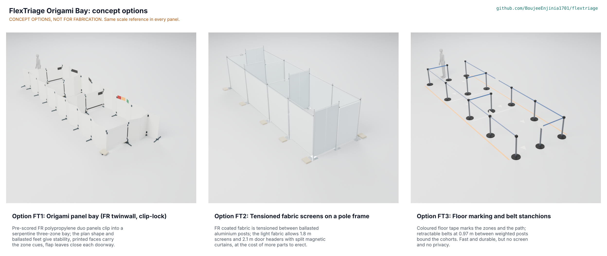

# FlexTriage Origami Bay concept options

Result: the origami panel bay (FT1, the team's concept) scores 176 of 260, floor marking with belt stanchions (FT3) 169 and tensioned fabric screens (FT2) 159. FT1 leads FT3 by 4 % and FT2 by 10 % (159 is within 10 % of 176), so **all three go to Amish without a pick** (STANDARDS section 21; FXT-DEC-001 D1). The engineering finding that separates them: none of the three is light or stiff. FT1 is 43.1 kg and stands a push only next to its stubs; FT2 is 53 to 64 kg and its posts tip at a few newtons; FT3 is about 267 kg of steel posts, each tipping at 34 N, and gives no screen. FT1 is carried in the drawing set, BOM and build plan so that a constructable design exists at TRL 3; that is not a choice. Method: STANDARDS section 21; numbers from FXT-CAL-001 and FXT-STM-001.

Figure 1. The three options at one scale (Blender render, to be produced from `/home/claude/he5/renderq/flextriage`).

## The options

### Option FT1: origami panel bay (team concept, iteration 2)

Pre-scored FXP-S4FR P12 duos, each folded 30 deg, clip into a serpentine bay with angle clips: two zigzag long walls, four zigzag stubs at alternate sides leaving doorways about 1.06 m clear, corner tails, anchor feet with ballast, one pin-hinged leaf with a magnetic catch per doorway, printed numerals and words. Built from `cad/src/flex_parts.py` (FXP-PLT-001). 181 parts at D3.

### Option FT2: tensioned fabric screens on a pole frame

The same plan drawn with 1.9 m FR PVC-coated polyester screens laced between 38 mm aluminium posts on 6 mm aluminium base plates with site-filled bags; door posts 2.1 m with headers carrying split magnetic curtains. 184 parts at D3.

### Option FT3: floor marking and retractable-belt stanchions

The same plan marked on the floor with 2 in vinyl tape and arrows, bounded by 14 belt stanchions at 0.97 m; doorways are unhooked belts; zone signs on post tops. 124 parts at D3.

## First-order numbers

Table 1. Options compared (FXT-CAL-001, model).

| Quantity | FT1 | FT2 | FT3 |
| --- | --- | --- | --- |
| Boundary height (mm) | 1,212 | 1,830 (fabric top) | 970 (belt) |
| Mass of one bay (kg) | 43.1 with bags | 53 to 64 | about 267 (steel posts) |
| Parts cost (USD, prototype) | 1,174.23 (BOM) | about 2,060 (commercial pipe and drape) | 844 (steel posts) to 1,198 (water-fill) |
| Lateral push before tipping | 312 N at a stub joint; 5 to 15 N between stubs | about 3 to 8 N per post | 34 N per post |
| Deployment by two people (estimate) | 12 to 35 min | longer than FT1 (posts, rails, lacing) | 11 to 26 min |
| Fire load | about 1,279 MJ (FR sheet) | FR fabric, about a third of FT1's mass of polymer | belts and tape only |
| Privacy | none to standing adults | yes | none |
| Parts count (model) | 181 | 184 | 124 |
| STEM check | S1, S6, S22 to Amish | X2, X5, X6 fail | X7, X8 fail |

## Patent check (FXT-FTO-001)

No live patent found reads on FT1's combination. The expired corrugated-board connector patents (US 4,828,894; US 4,565,465) and the expired folding partition (US 7,213,632 B1) are prior art. FT2 is near the active Standex gurney screen patent (US 9,038,214 B2) only in using collapsible poles and a screen; FT2 stands on the floor and attaches to no bed. FT3 uses ordinary manual belt stanchions, not the motorized barrier of US 12,168,590 B2. This is not legal advice.

## Scoring

Table 2. Weighted scoring (weights: High UR 3, Medium 2, Low 1; scores 1 to 5). Maximum 260.

| Criterion | Source | Weight | FT1 | FT2 | FT3 | Reason |
| --- | --- | --- | --- | --- | --- | --- |
| Fast set-up | UR-001 | 3 | 3 | 2 | 3 | 12 to 35 min; FT2 has more steps; FT3 11 to 26 min but heavy posts |
| Zones and one-way flow | UR-002 | 3 | 5 | 5 | 4 | Belts unhook and the path is less defined |
| Boundary between cohorts | UR-003 | 3 | 4 | 4 | 2 | Continuous walls against a belt line people duck under |
| Clear cues | UR-004 | 3 | 5 | 4 | 3 | Large printed faces; printed fabric; floor tape soils |
| Stays standing | UR-005 | 3 | 2 | 1 | 2 | All tip away from braced points; FT1 312 N at stubs |
| Wipe clean | UR-006 | 3 | 4 | 3 | 4 | PP faces; coated fabric seams; steel posts |
| Fire | UR-007 | 3 | 3 | 3 | 5 | FT3 has almost no fuel |
| Carry | UR-008 | 3 | 2 | 1 | 1 | 43.1, 53 to 64 and 267 kg |
| Floor space | UR-009 | 2 | 3 | 3 | 3 | Same plan |
| Stretcher passage | UR-010 | 2 | 4 | 4 | 5 | 1,054 to 1,069 mm doorways; FT3 belts unhook fully |
| Privacy | UR-011 | 2 | 2 | 5 | 1 | Only FT2 hides a standing adult |
| Reusable 50 times | UR-012 | 3 | 3 | 4 | 5 | Printed hinges and clips unproven |
| Affordable | UR-013 | 3 | 3 | 2 | 3 | USD 1,174, about 2,060, 844 to 1,198 |
| Easy passage | UR-014 | 2 | 4 | 4 | 3 | Push plate; curtain touches; belts unhooked by hand |
| Honest and lawful | UR-015 | 3 | 4 | 4 | 4 | Same claims register |
| Tent and hall floors | UR-016 | 2 | 3 | 3 | 3 | All need level floors |
| Local repair | UR-017 | 1 | 4 | 3 | 2 | Sheet and prints; tubes and fabric; bought posts |
| Cost against the target | | 2 | 3 | 2 | 3 | As UR-013 |
| Buildable with local skills | | 2 | 4 | 3 | 5 | Knife, router and printer; sewing; bought |
| Safety | | 3 | 3 | 2 | 3 | FT2's 2.1 m posts and headers fall further |
| Maintenance | | 1 | 3 | 3 | 4 | Fewest loose parts in FT3 |
| **Weighted total** | | | **176** | **159** | **169** | |

## Recommendation

All three go to Amish (within 10 %), recorded as **proposed, awaiting Amish** in FXT-DEC-001 D1 and argued in FXT-DDR-001. The engineering view, for Amish to weigh: FT1 gives the clearest zones and cues and keeps the team's concept and the shared platform; FT3 is the quickest, most durable and least combustible, and is the honest choice if a boundary that tips anyway is acceptable; FT2 is the only one with privacy. The runner-up's best idea, FT3's floor tape for the path and the 1 m spacing, is proposed as an add-on to FT1 (D1).

Licence: this document is licensed under CC-BY-4.0 (Creative Commons Attribution 4.0 International), following the Helpful Engineering licensing guide. Design Molecule Labs with Helpful Engineering.
