# FlexTriage Origami Bay prototype build plan

Plan, not yet built. This plan tells a capable maker how to make and put together the first proof-of-concept three-zone bay (option FT1), component by component, with a picture for every part and step. It describes the design as it stands; decisions still open are in the design decisions register (FXT-DEC-001). The parts cost about USD 1,174 (bom/bom.csv). CONCEPT, NOT FOR FABRICATION.

Release limitation: no prototype is used in patient care until its stability, fire performance, cleanability and the procedure it embeds are reviewed by qualified infection prevention and control (IPC) and safety staff.

## 1. What you are building

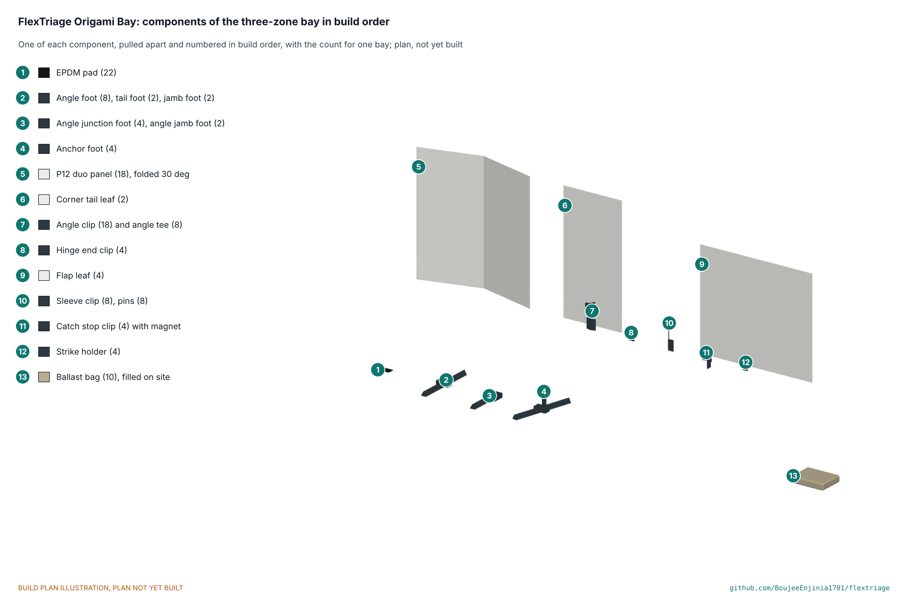

Figure 1. One of each component, numbered in build order, with the count for one bay.

A bay 8.2 m long and 2.3 m wide of 1.2 m high panels: two long walls of seven folding panels each, four short panels standing out from the walls at alternate sides, and a doorway about 1.06 m clear beside each short panel, so the path snakes through three zones: 1 intake, 2 assessment, 3 treatment. Every panel stands folded 30 deg at its groove, so the walls zigzag (the platform's rule S1: no panel stands flat); every joint is a printed angle clip or angle tee; every joint stands in a printed foot on a rubber pad; each short panel ends in an anchor foot loaded with two 5 kg sand bags; each doorway has one swinging leaf that closes on a magnet.

## 2. What changed to make it buildable

| Concept (team deck, iteration 2) | Constructable design | Why |
| --- | --- | --- |
| Zones coloured green and red | Numeral, word and arrow in dark on light; triage colours only as category bands with the word | Triage and safety colours already mean patient categories and fire or safe condition |
| Two magnetic flaps meeting in the middle | One leaf per doorway, opening forward only, closing on a stop with the magnet pulling a steel disc | A magnet sliding sideways over its strike held about 2 N |
| Short panels standing in plain feet | Anchor feet that clip the short panel's lower holes, carrying two bags | In a plain foot the panel lifts out and leaves its ballast behind |
| Plain corner joints at the two end panels | A 600 mm tail panel outside each corner, making it a tee | The corner's clip had to resist the push in pull-out at a factor of about 1 |
| Feet straight on the floor | A 2 mm rubber pad under every foot | Hard plastic feet slide at under half the push |
| Straight walls of flat panels | Zigzag walls and short panels: each panel folded 30 deg, each joint an angle clip | A flat 1.2 m panel can buckle under its own weight in a warm tent |
| Feet with outriggers everywhere | No outrigger or bag in a doorway; bags on the upstream side, clear of the leaf | A leaf swept 3.5 mm over a bag; outriggers are a trip edge |
| Open hinge gap | Rubber finger guards on both faces | The gap opens and closes between 0 and 12 mm |
| Back of each short panel's fold open | Clear PP cover strip over the groove | The 13.6 mm groove faces a zone and cannot be wiped |

## 3. Making the components

Make every component and check it before the step that needs it. Cut panels on a clean bench; print the clips and feet in PETG with full infill at the snap tongues and pegs.

### 3.1 Wall panel (18) and corner tail (2)

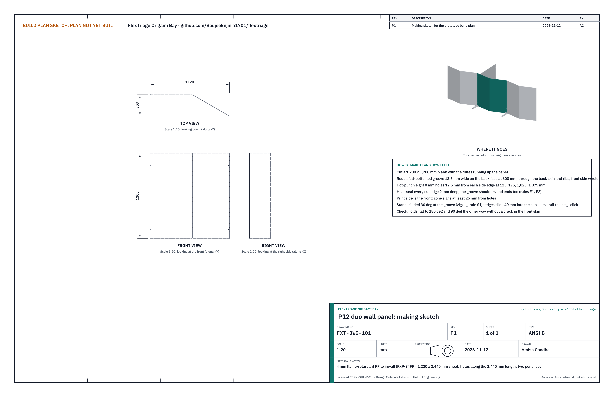

Figure 2. Making sketch FXT-DWG-101.

What it is: a 1,200 x 1,200 mm folding panel of 4 mm flame-retardant polypropylene twinwall, cut two to a 1,220 x 2,440 mm sheet with the flutes running up the panel.

1. Mark and cut the blank square to within 1 mm; keep the flutes vertical.
2. Rout a flat-bottomed groove 13.6 mm wide (four flute pitches) on the back face at 600 mm, through the back skin and the ribs, leaving the front skin whole.
3. Hot-punch eight 8 mm holes, 12.5 mm in from each side edge, at 125, 175, 1,025 and 1,075 mm up from the bottom edge.
4. Heat-seal every cut edge about 2 mm deep so the flute ends are fused shut, and the groove's shoulders and ends too.
5. For the four short panels, heat-stake or tape the clear PP cover strip along both shoulders of the back-face groove.
6. Print the fold direction and "30 deg" on the back face beside the groove.
7. For the two corner tails, cut 600 x 1,200 mm leaves with no groove and the same holes.

How it fits: each side edge slides 40 mm into a clip slot until it meets the clip's core and both pegs drop into its holes. The bottom edge sits in the angled slots of the feet, 12.5 mm above the floor, which set the 30 deg fold. Print faces into the zones; the groove faces out of the bay on the long walls.

Check: the panel folds flat to 180 degrees and 90 degrees the other way with no crack in the front skin; the holes line up with a clip held against them.

### 3.2 Clips (26), hinge end clips (4) and sleeve clips (8)

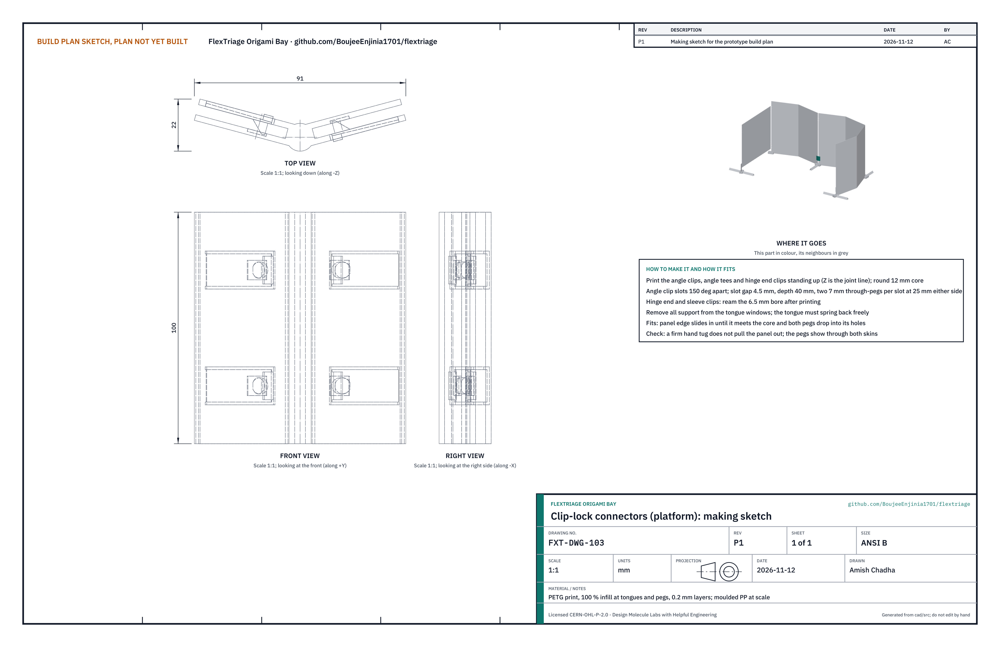

Figure 3. Making sketch FXT-DWG-103.

What they are: the platform's clip-lock connectors, 100 mm tall, with 4.5 mm slots and through-pegs: 18 angle clips (two slots 150 degrees apart) and 8 angle tees (the two wall slots and one for a short panel or tail); four hinge end clips and eight sleeve clips with a 6.5 mm bore for the hinge pins. All have a round 12 mm core.

1. Print each clip standing up, with the slots open at the top.
2. Clear all support from the tongue windows; each tongue must spring back on its own.
3. Ream the 6.5 mm bores of the hinge end and sleeve clips.

How they fit: a panel edge pushed into a slot lifts the tongue on the peg's ramp; at full depth the peg drops through both skins of the panel into the socket in the back wall. Release by pulling both lips while the other hand pulls the panel.

Check: a firm hand tug does not pull a clipped panel out; the tongue clicks audibly.

### 3.3 Flap leaf (4)

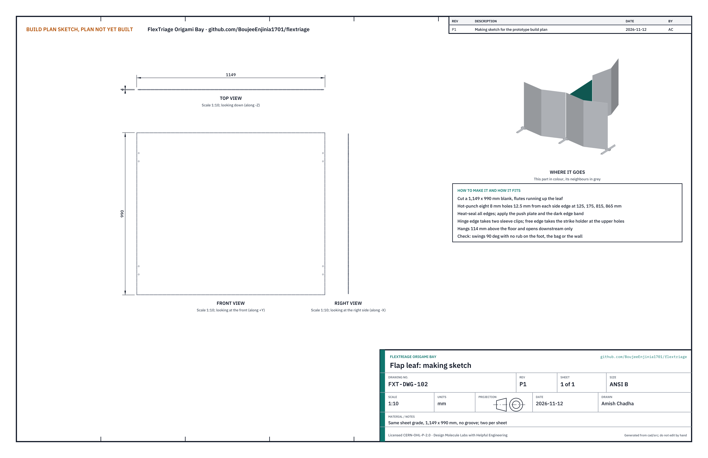

Figure 4. Making sketch FXT-DWG-102.

What it is: a 1,149 x 990 mm leaf of the same sheet, two to a sheet, no groove.

1. Cut the blank, flutes vertical.
2. Hot-punch eight 8 mm holes 12.5 mm from each side edge at 125, 175, 815 and 865 mm.
3. Heat-seal all edges; apply the push plate print and the dark band along the bottom.
4. Clip two sleeve clips on the hinge edge and the strike holder on the free edge at the upper holes.

How it fits: the sleeves drop over the two hinge pins at the end of a short panel; the leaf hangs 114 mm above the floor and swings forward only.

Check: the leaf swings through 90 degrees without touching the foot, the bags or the wall.

### 3.4 Anchor foot (4)

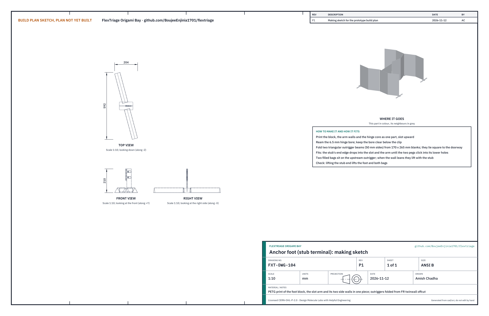

Figure 5. Making sketch FXT-DWG-104.

What it is: the platform foot block, the lower hinge clip and the two side walls joining them, printed as one part, with two folded outriggers that lie square to the doorway.

1. Print the block and the clip in one piece, slot upward.
2. Ream the 6.5 mm hinge bore; keep the space under the clip clear for the pin's end.
3. Fold two triangular outrigger beams with 50 mm sides from 170 x 265 mm offcut blanks and push them onto the block.
4. Bond a rubber pad under the block.

How it fits: the short panel's end edge drops into the slot and into the clip's arm until both pegs click into its lowest holes. Two filled bags lie stacked on the upstream outrigger.

Check: lifting the end of the short panel lifts the foot and both bags with it.

### 3.5 Catch stop clip (4) and strike holder (4)

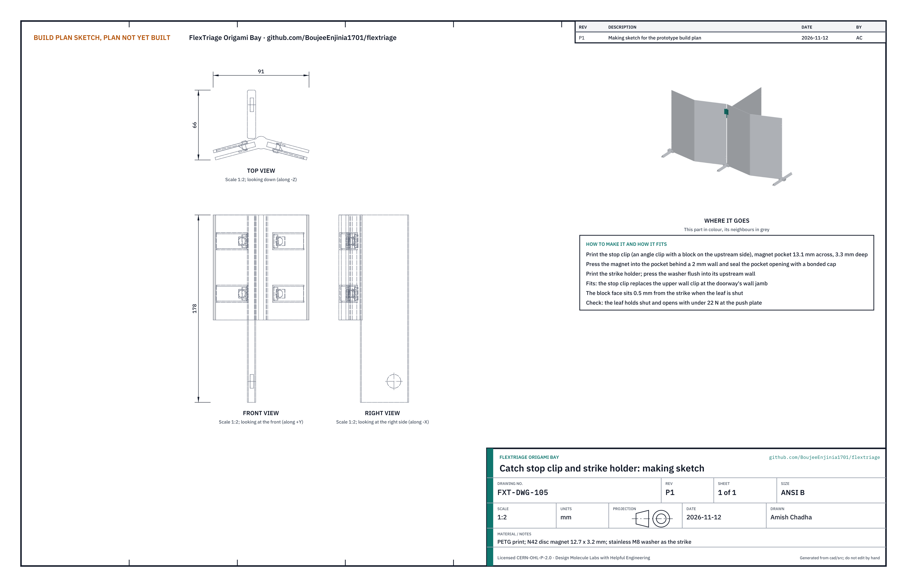

Figure 6. Making sketch FXT-DWG-105.

What they are: the stop clip replaces the upper wall clip at each doorway's wall side and carries a block on the upstream side holding a 12.7 mm disc magnet behind a 2 mm wall; the strike holder carries a flush steel washer on the leaf's free edge.

1. Print the stop clip and the strike holder.
2. Press the magnet into its pocket and seal the pocket opening with a bonded cap.
3. Press the washer flush into the strike holder's upstream face.
4. Stick the pacemaker label on the block.

How they fit: with the leaf shut, the washer sits 0.5 mm from the block's face and the magnet pulls the leaf against the stop.

Check: the leaf holds shut on its own and opens with less than 22 N at the push plate.

### 3.6 Angle feet (8), tail feet (2), jamb feet (2), angle junction feet (4) and angle jamb feet (2)

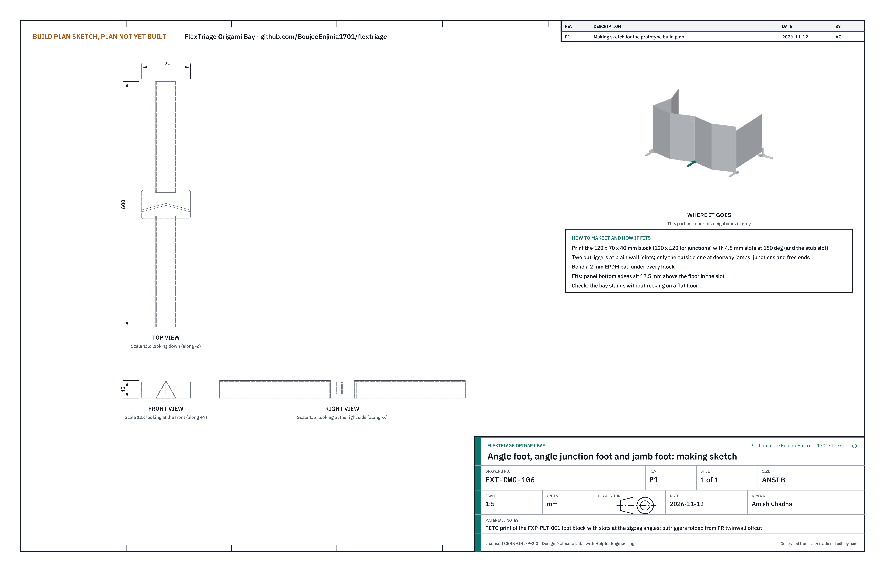

Figure 7. Making sketch FXT-DWG-106.

1. Print the 120 x 70 x 40 mm blocks with two 4.5 mm slots 150 degrees apart (angle feet and angle jamb feet), the 120 x 120 x 40 mm blocks with three slots (angle junction feet), and plain platform blocks for the tail ends and the free wall ends.
2. Fold and fit two outriggers to each angle foot and tail foot, and one, on the outside of the bay, to each jamb foot, angle jamb foot and junction foot.
3. Bond a rubber pad under every block.

Check: every block sits flat without rocking; each foot type fits only its own joint.

### 3.7 Bought parts

Hinge pins: 6 mm stainless clevis pins about 215 mm long with split pins, and a stainless M6 washer for each lower hinge. Disc magnets 12.7 x 3.2 mm, grade N42. Stainless M8 washers as strikes (a magnetic grade). Ten coated sand bags about 380 x 330 mm, filled with 5 kg of clean sand each, away from the clinical floor. Rubber sheet 2 mm for the pads and 0.8 mm strips for the finger guards. Printed signs under clear overlaminate. Three flat carry bags.

## 4. Putting it together

Two people, from the bags. Fill the sand bags before you start.

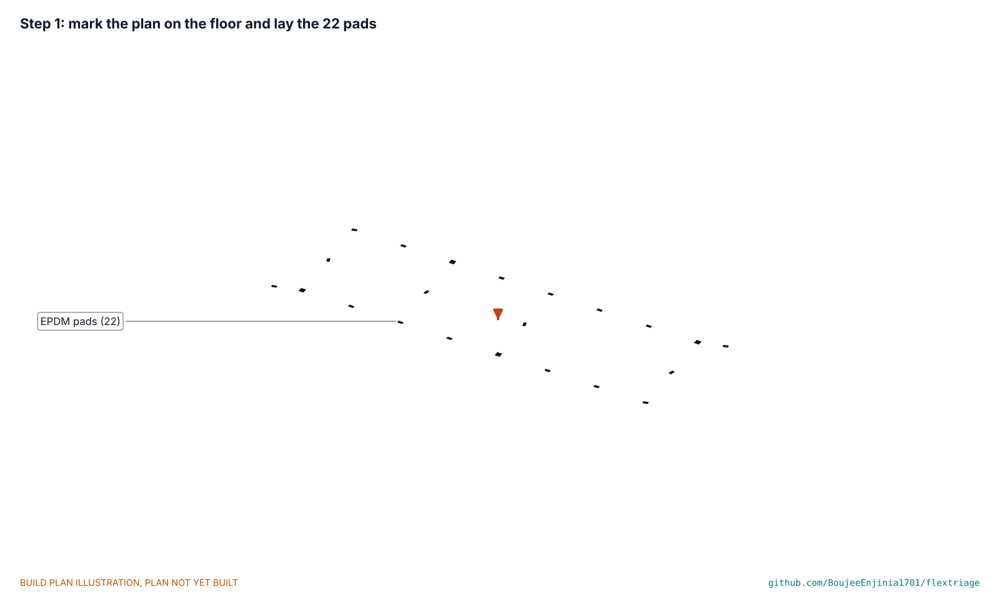

Figure 8. Step 1: mark the plan on the floor and lay the pads. The plan needs 8.8 x 2.9 m clear, plus 1.5 m at the entry and the exit, off the host hall's or tent's exit routes.

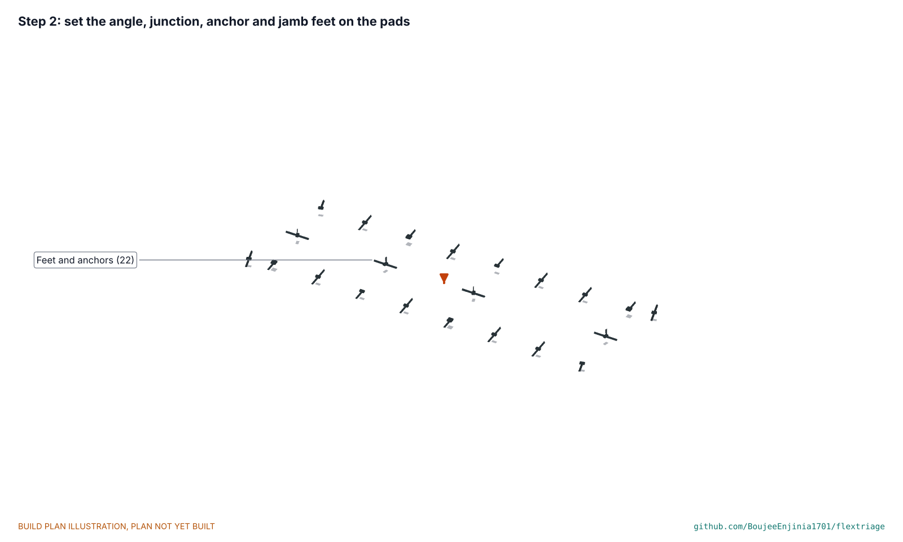

Figure 9. Step 2: set the angle, junction, anchor and jamb feet on their pads, each on its mark. The colour on each block matches the mark.

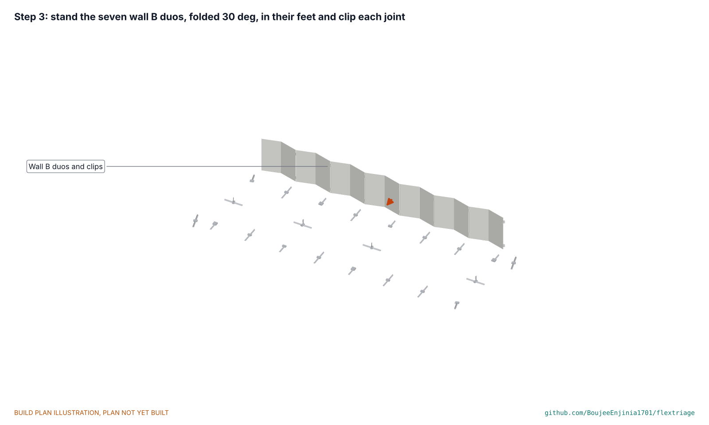

Figure 10. Step 3: stand the seven panels of the back wall in their feet, each folded 30 degrees with the fold pointing out of the bay, and clip each joint at both heights.

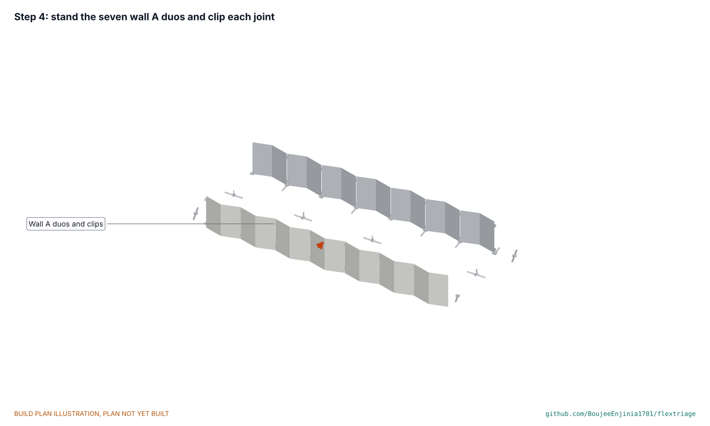

Figure 11. Step 4: stand the seven panels of the front wall the same way.

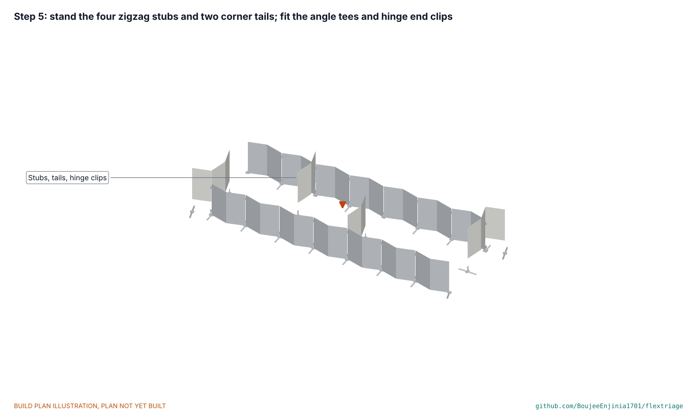

Figure 12. Step 5: stand the four short panels, folded 30 degrees, into their angle tees and anchor feet, and the two corner tails; fit the upper hinge end clips on the short panels' ends.

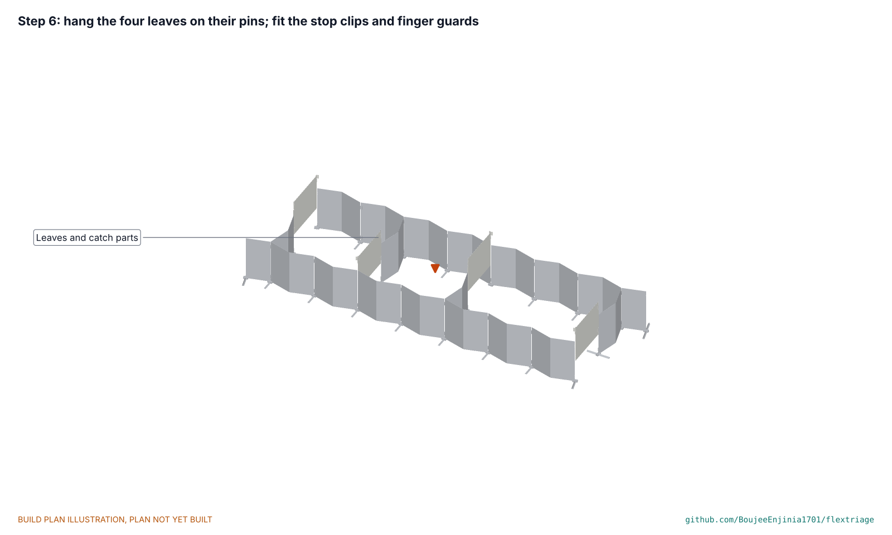

Figure 13. Step 6: drop each leaf's sleeves over the lower pin, push the upper pin down through the hinge end clip and the upper sleeve, fit the split pins; fit the stop clips and the finger guards. Hold point: every leaf swings forward and closes on its catch.

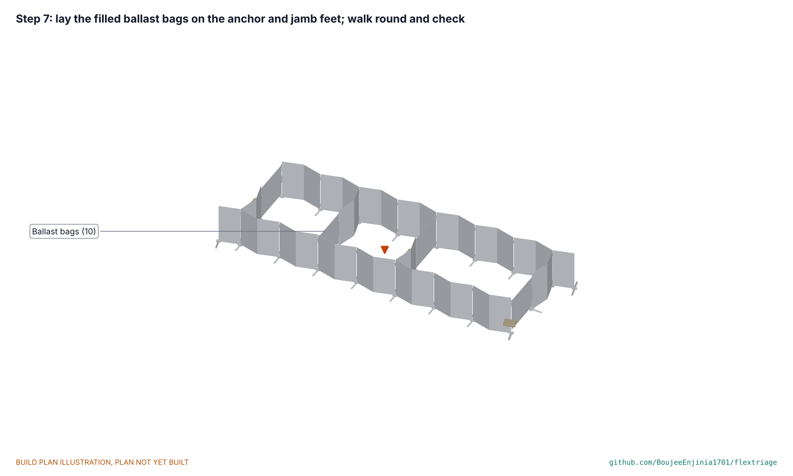

Figure 14. Step 7: lay two filled bags on the upstream outrigger of each anchor foot and one on each jamb foot; walk round and check every clip and witness line.

Joint close-ups:

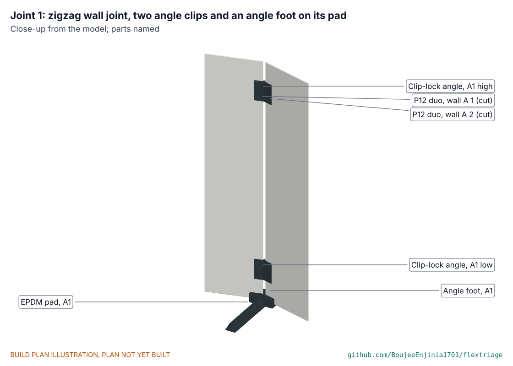

Figure 15. Joint 1: a zigzag wall joint with its two angle clips and an angle foot.

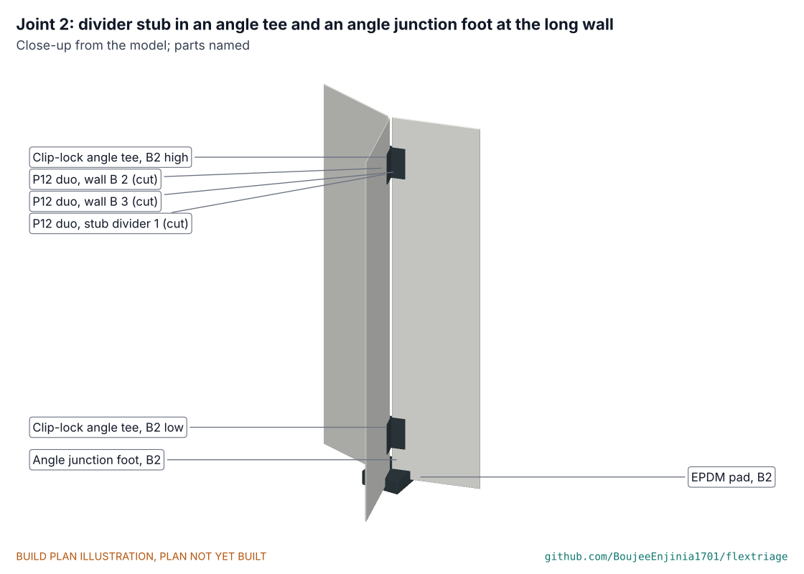

Figure 16. Joint 2: a short panel in an angle tee, on an angle junction foot.

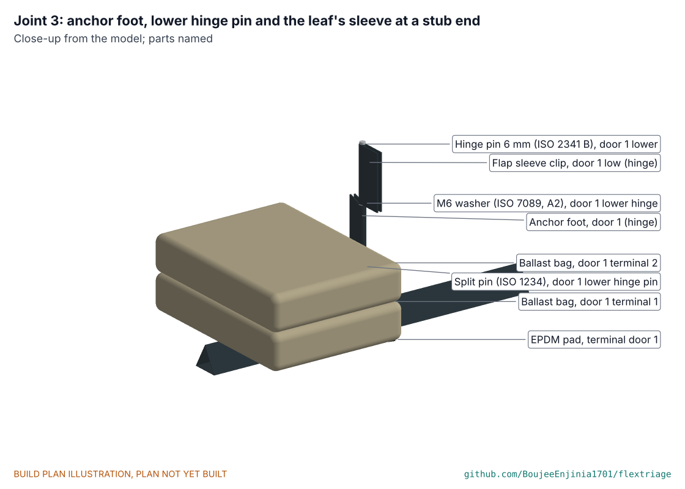

Figure 17. Joint 3: the anchor foot and the lower hinge at the end of a short panel.

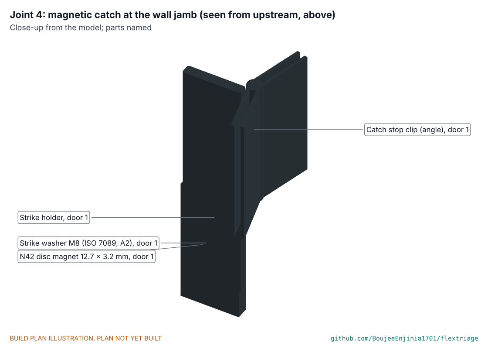

Figure 18. Joint 4: the magnetic catch at a doorway's wall side.

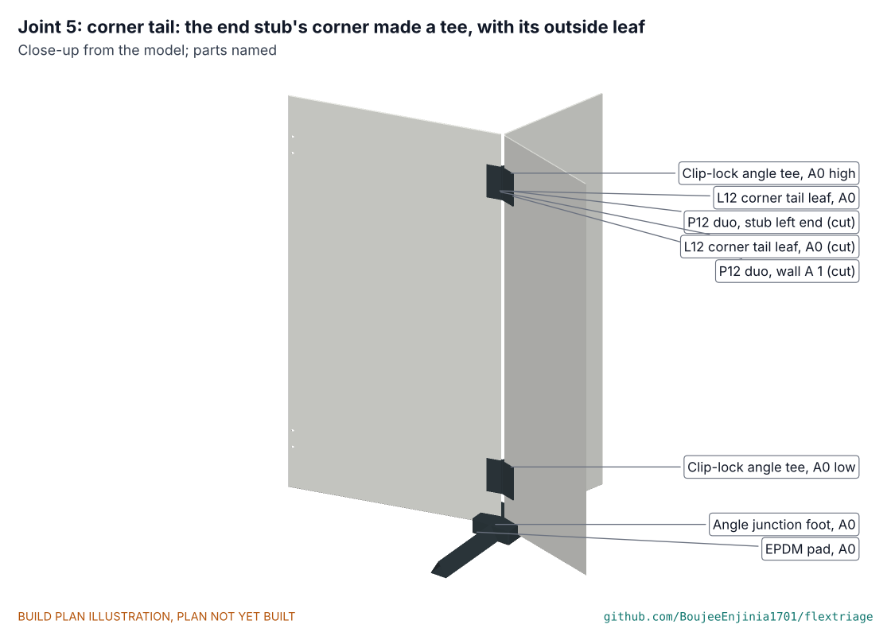

Figure 19. Joint 5: a corner tail turning the end corner into a tee.

## 5. First checks

Each check is tied to a requirement; the TRL 4 test report records the result.

| Check | Requirement | Pass |
| --- | --- | --- |
| Time two untrained people from bags to the final walk round | PR-001, PR-025 | Under 15 min; every foot type fitted to its own joint first time |
| Walk the path: entry, 1, 2, 3, exit, one way | PR-002, PR-024 | One doorway between zones, at alternate sides |
| Stand at each doorway and look over the walls | PR-003 | Heads and upper bodies visible in the next zone |
| Read every sign from the far corner of its zone | PR-004, PR-005 | All words read; no process zone in red, yellow or green |
| Push each wall with 178 N at 1,110 mm next to a short panel | PR-006, PR-008 | No tip, no slide |
| Push a wall between short panels | PR-007 | Record the force at which it moves (criterion set in D7) |
| Wipe every face, edge and groove with 0.5 % hypochlorite and 70 % alcohol | PR-009 | No lifting, no liquid behind seals |
| Check the sheet's fire report and grammage | PR-010 | NFPA 701 TM1 report for the bought lot, at most 700 g/m2 |
| Measure the clear floor and doorway widths | PR-011, PR-012, PR-013, PR-019 | 1,054 to 1,069 mm at the floor; 1 m from heat sources; off exit routes |
| Open each leaf at its push plate with a force gauge | PR-014 | Under 22 N; holds shut alone |
| Weigh the bags | PR-015, PR-016 | Record against 12 kg in total; no bag over 23 kg |
| Swing a leaf by machine | PR-017 | 150,000 swings without wear-through |
| Stand the bay on a 1:50 slope and after a warm soak | PR-021, PR-028 | No tilt beyond the feet; no buckling; folds hold 30 degrees |
| Check the privacy at assessment and treatment | PR-022 | Record what a standing adult sees |
| Replace one panel and one clip from spares | PR-023 | Done with sheet and a print, no special part |
| Check finger guards and doorways for trip edges | PR-026 | No bag or outrigger in a doorway |
| Check the pacemaker labels | PR-027, PR-020 | One on every stop block; wording as the claims register |

## 6. Safety stops

- Before standing any panel: the floor is level, dry and clear for 8.8 x 2.9 m plus the approaches, and off the host's exit routes.
- Before hanging a leaf: both short-panel ends are in their anchor feet with both bags laid; a leaf hung on an unballasted short panel can pull it over.
- Before any push test: a second person stands behind the wall; nobody stands on the far side.
- Before any patient use: the IPC and safety review of the release limitation is done.
- Do not lean on, sit on or hang anything on a wall. Keep 1 m from heaters, flames and oxygen outlets. Keep pacemaker wearers 10 cm from the catches.

## 7. Tools, skills and workspace

A clean bench 2.5 x 1.3 m, a straight edge and knife, a router with a 13.6 mm flat-bottomed cutter set to the front skin, a hot punch for 8 mm holes, an edge-sealing iron, one or more desktop printers for PETG (about 670 printer-hours for one bay, so a print pool), a reamer for 6.5 mm bores, a force gauge and a tape. Skills: sign-shop sheet work and printing.

## 8. Where the numbers come from

- Model: `cad/src/model.py` (option FT1), built from `cad/src/flex_parts.py` (FXP-PLT-001).
- Drawings: `cad/drawings/FXT-DWG-001` (general arrangement), `FXT-DWG-002` (doorway), `FXT-DWG-101` to `106` (making sketches).
- Calculation note: FXT-CAL-001 (`docs/04-calcs/01-sizing.md`, `sizing.py`).
- Bill of materials: `bom/bom.csv`.

Licence: this document is licensed under CC-BY-4.0 (Creative Commons Attribution 4.0 International), following the Helpful Engineering licensing guide. Design Molecule Labs with Helpful Engineering.
